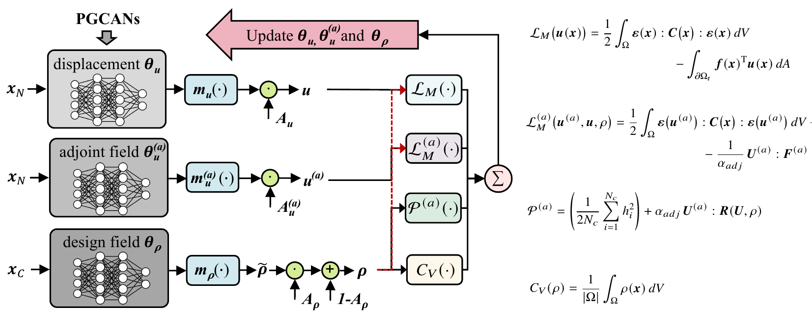
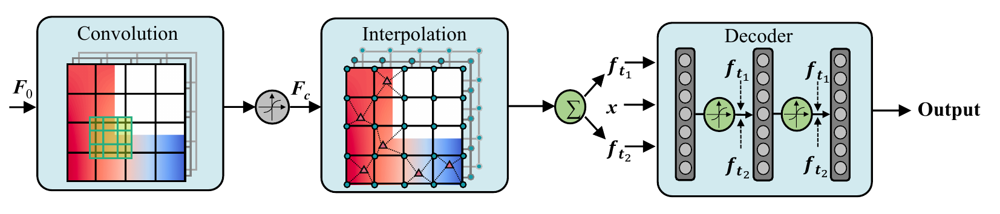
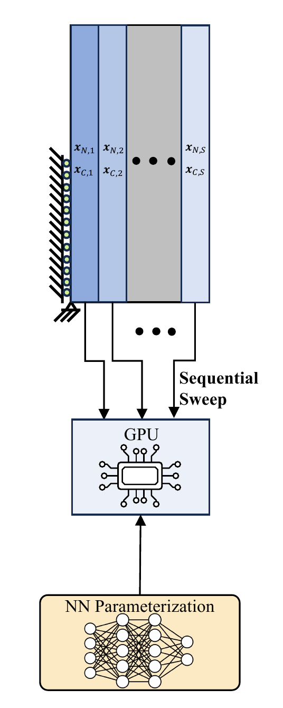
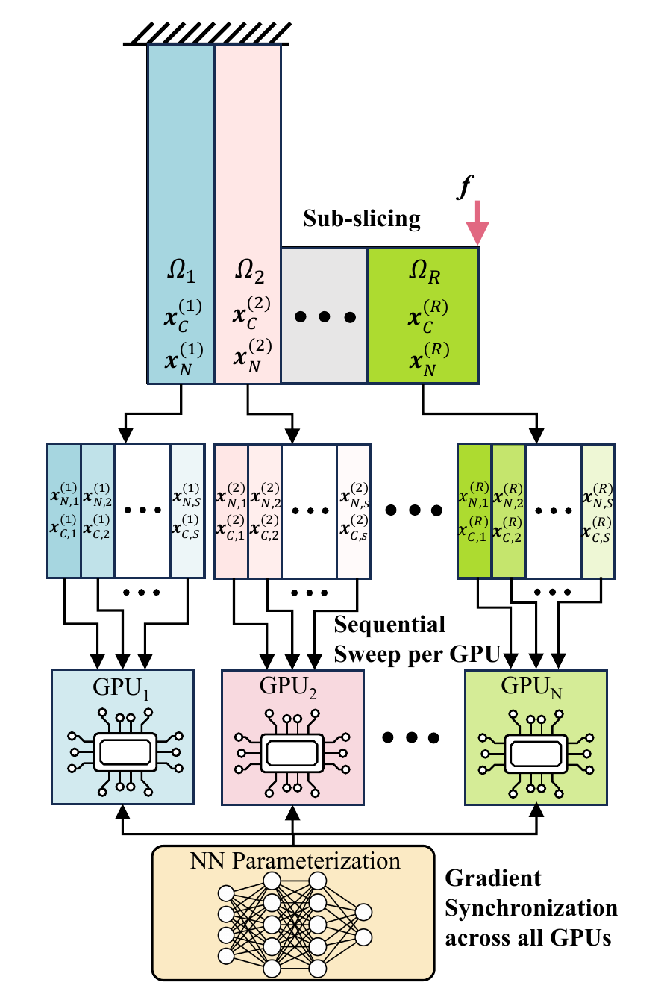
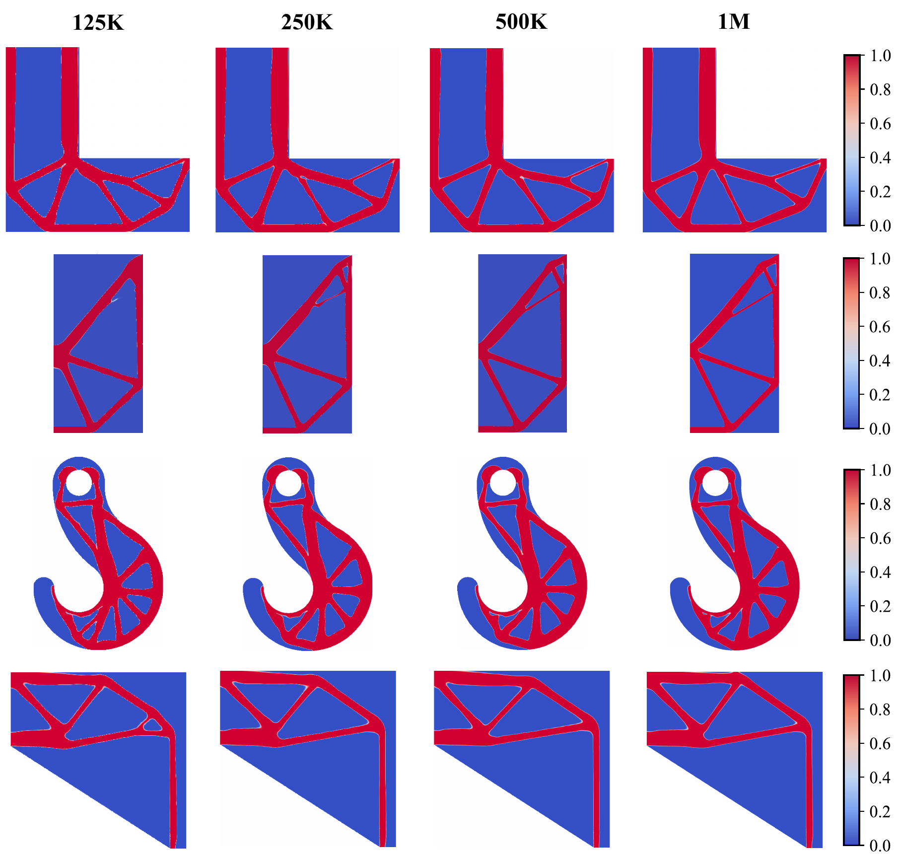
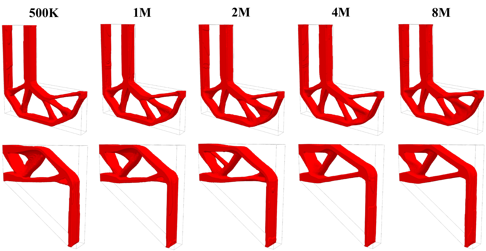
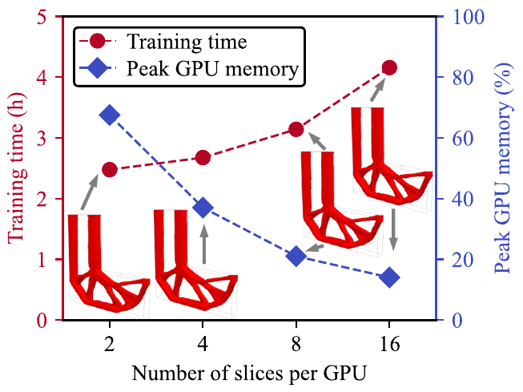
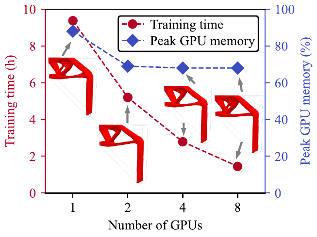

# SNTO: Scalable Stress-Constrained Neural Topology Optimization

Official implementation of **Simultaneous Neural Topology Optimization (SNTO)**, a multi-GPU framework for stress-constrained topology optimization with millions of local stress constraints.

> Xiangyu Sun, Shirin Hosseinmardi, Ramin Bostanabad, *Scalable Stress-Constrained Topology Optimization: A Super-resolution and Simultaneous Approach Based on Machine Learning*, University of California, Irvine, 2026.

## Overview

SNTO represents the displacement, adjoint, and density fields with three independent neural networks (PGCAN architecture) and trains them **simultaneously** in a single optimization loop. The loss combines the volume-fraction objective, a quadratic penalty on the local von Mises stress constraints, and the potential energy functionals of the state and adjoint problems. Boundary conditions and prescribed solid/void regions are imposed exactly through distance functions, so no boundary penalty terms are needed.

<p align="center">
  
  <br>
  
  <br>
  <em>SNTO framework: three networks evaluated at nodal and centroid collocation points (CPs) and trained jointly on one composite loss.</em>
</p>

## Multi-GPU training without interface conditions

The loss gradient is **additive over any partition of the collocation points**. SNTO exploits this in two levels:

1. **Subdomains across GPUs** — the design domain is sliced into equal-CP subdomains, one per GPU. Each GPU accumulates the gradients of its subdomain and the gradients are summed by an all-reduce (PyTorch DDP) before every parameter update.
2. **Sub-slices within a GPU** — each subdomain is further split into sub-slices that are processed sequentially with gradient accumulation, which bounds the peak GPU memory.

Because every network is a single global function of the coordinates, all three fields are continuous across subdomain boundaries by construction. Unlike domain-decomposition PINNs, no interface residual losses or ghost-node exchanges are required, and the optimization result is independent of how the domain is partitioned.

<p align="center">
  
  &nbsp;&nbsp;&nbsp;&nbsp;
  
  <br>
  <em>Left: sequential sub-slicing on one GPU. Right: subdomains distributed across GPUs with gradient all-reduce.</em>
</p>

**Measured scaling (3D portal frame, 2M nodal CPs, NVIDIA A100):**

| GPUs | Sub-slices / GPU | Training time | Speedup | Parallel efficiency |
|:---:|:---:|:---:|:---:|:---:|
| 1 | 8 | 9.4 h | 1.0× | — |
| 2 | 4 | 5.2 h | 1.8× | 90% |
| 4 | 2 | 2.8 h | 3.4× | 84% |
| 8 | 1 | 1.5 h | 6.3× | 79% |

Sub-slicing a 1M-CP problem on two GPUs from 2 to 16 sub-slices per GPU reduces peak memory from 68% to 14% of the device while producing the same topology.

## Mesh-independent designs from 125K to 8M collocation points

The design is parameterized by the networks, not by the mesh, so refining the collocation points only refines the evaluation of the loss. No density filter is used. The optimized topologies remain consistent as the number of nodal CPs grows from 125K to 1M in 2D and from 500K to 8M in 3D.

<p align="center">
  
  <br>
  <em>2D benchmarks (L beam, crack, hook, portal frame) with 125K, 250K, 500K, and 1M nodal CPs on a single GPU.</em>
</p>

<p align="center">
  
  <br>
  <em>3D L beam and portal frame with 500K to 8M nodal CPs, trained on up to four GPUs.</em>
</p>

All designs are verified by an independent finite element analysis (FEniCSx) of the remeshed geometry; in 2D the stress fields match or improve on PolyStress at lower volume fractions.

## Computational cost and memory

<p align="center">
  
  &nbsp;&nbsp;&nbsp;&nbsp;
  
  <br>
  <em>Left: sub-slicing sweep on the 3D L beam with 1M nodal CPs on two GPUs. Increasing the number of sub-slices per GPU from 2 to 16 lowers the peak GPU memory from 68% to 14% at the cost of a longer training time. Right: multi-GPU sweep on the 3D portal frame with 2M nodal CPs. The number of sub-slices per GPU is reduced from 8 to 1 as the number of GPUs grows from 1 to 8, which keeps the peak memory constant while the training time drops from 9.4 h to 1.5 h. The optimized topologies, shown next to the data points, are unaffected by the partitioning.</em>
</p>

## Highlights

- Millions of local stress constraints handled directly, without p-norm or KS aggregation.
- Simultaneous (SAND-type) optimization: state, adjoint, and design updated in one loop.
- Near-linear speedup across GPUs and tunable peak memory through sub-slicing.
- Mesh-independent, near-binary designs without filtering.
- Up to 8M nodal CPs in 3D on four A100 GPUs; 2D problems up to 1M CPs on one GPU.

## Repository layout

```
Code/
├── Generate_mesh/
│   ├── Generate_Mesh_2D/            Step1 … Step5: background mesh -> training data (.pt) for the 2D benchmarks
│   └── Generate_Mesh_3D/
│       ├── L_beam/                  Step2 … Step5 (+ Step6/7 FEniCSx checks) for the 3D L beam
│       └── Portal_frame_half/       same pipeline for the 3D portal frame
├── SNTO 2D/
│   ├── C1_<example>_TO2_Delta.py    2D drivers, 125K nodal CPs (L_beam, Crack, Hook, Portal_frame_half)
│   ├── C2_<example>_TO2_Delta.py    2D drivers, 250K nodal CPs
│   ├── *.slurm                      Slurm job scripts used on NCSA Delta (A100)
│   ├── Data/                        training data (.pt) -- the four 125K files are included
│   ├── models/                      PGCAN network definitions
│   └── utils/                       data loading, domain slicing, gradient accumulation
└── SNTO 3D/
    ├── C{2,4,6,7,8}_<example>_TO9_Sophia.py   3D drivers for 500K, 1M, 2M, 4M, 8M nodal CPs
    ├── *.pbs                        PBS job scripts used on ALCF Sophia (A100)
    ├── Data/                        put the generated 3D .pt files here (too large for GitHub)
    ├── preprocess_cache_3D_density.py, plot_3D_density_figure.py, plot_history.py   post-processing
    ├── models/  utils/
```

Dependencies: Python 3.10+, PyTorch with CUDA, NumPy, Matplotlib, tqdm, and [gmsh](https://pypi.org/project/gmsh/) (mesh generation only). The optional verification and plotting scripts need `dolfinx` (FEniCSx) and `pyvista`.

## Step 1 — Generate the background mesh and training data

SNTO evaluates the displacement and adjoint networks at the nodes of a background mesh and the density and stress at the element centroids. The `Generate_mesh` scripts build that mesh with gmsh, write it as an Abaqus `.inp`, and precompute everything the trainer needs (nodal and centroid coordinates, connectivity, B-matrices, element volumes, load vectors) into a single `.pt` file. Each script has a small parameter block at the bottom (`example`, `sampling_size`, …); edit it, then run the steps in order from inside the folder.

**2D** (`Code/Generate_mesh/Generate_Mesh_2D`)

```bash
python Step1_generate_contours.py   # boundary point cloud -> <example>_sampling_size<h>/contour_00.json
python Step2_generate_mesh.py       # gmsh quad mesh      -> <example>_sampling_size<h>/*.msh
python Step3_write_abq_inp.py       # .msh -> Mesh_01.inp (CPS4R)
python Step4_process_mesh.py        # .inp -> <example>_mesh.pt (nodes, connectivity, centroids)
python Step5_generate_data.py       # -> <example>_GPU1_CPS4_reduced.pt (loads, B-matrices, areas)
```

Set the same `example` (`L_beam`, `Crack`, `Hook`, `Portal_frame_half`) and `sampling_size` in all five scripts. The sampling sizes used in the paper are

| Nodal CPs | L_beam | Crack | Hook | Portal_frame_half |
|:---:|:---:|:---:|:---:|:---:|
| 125K | 0.2268 | 0.3998 | 0.253  | 0.146   |
| 250K | 0.1602 | 0.2828 | 0.178  | 0.103   |
| 500K | 0.1131 | 0.2    | 0.1258 | 0.0728  |
| 1M   | 0.0799 | 0.1414 | 0.08896| 0.05148 |

**3D** (`Code/Generate_mesh/Generate_Mesh_3D/L_beam` or `Portal_frame_half`)

The 3D meshes are structured hexahedral meshes (`method = "structured"` in Step 2), so Step 1 is not needed:

```bash
python Step2_generate_mesh_3D.py    # transfinite hex mesh -> <example>_sampling_size<h>/*_hex3d_*.msh
python Step3_write_abq_inp_3D.py    # .msh -> Mesh_01_3D.inp (C3D8)
python Step4_process_mesh_3D.py     # .inp -> <example>_3D_mesh.pt
python Step5_generate_data_3D.py    # -> <example>_3D_GPU1_C3D8R.pt
```

Sampling sizes used in the paper (`thickness = 10`):

| Nodal CPs | L_beam | Portal_frame_half |
|:---:|:---:|:---:|
| 500K | 0.525 | 0.445  |
| 1M   | 0.408 | 0.351  |
| 2M   | 0.325 | 0.28   |
| 4M   | 0.257 | 0.223  |
| 8M   | 0.203 | 0.1768 |

`Step6_verification.py` and `Step7_verification_w.py` are optional FEniCSx checks of the generated mesh. Keep `N_worker = 1` in Step 5: the trainer slices the single-GPU data file across GPUs and sub-slices at run time, so one file serves every GPU configuration.

**Rename and move the data file.** The drivers look for `Data/<Example>_GPU1_<Diff_type>.pt`, where `Diff_type` carries the resolution tag (`CPS4_reduced_125K`, `C3D8R_2M`, …). Append the tag to the file produced by Step 5 and move it into the `Data` folder of the corresponding trainer:

```bash
# 2D, e.g. L beam with 250K nodal CPs
mv L_beam_GPU1_CPS4_reduced.pt  "../../SNTO 2D/Data/L_beam_GPU1_CPS4_reduced_250K.pt"

# 3D, e.g. L beam with 2M nodal CPs
mv L_beam_3D_GPU1_C3D8R.pt      "../../../SNTO 3D/Data/L_beam_3D_GPU1_C3D8R_2M.pt"
```

The four 2D 125K files (`Crack`, `Hook`, `L_beam`, `Portal_frame_half`) are shipped in `SNTO 2D/Data` so the 2D examples run out of the box. The 3D files range from 330 MB (500K) to 5.5 GB (8M) and must be generated.

## Step 2 — Run SNTO

Every driver is self-contained: the parameter block under `Define Parameters` in `__main__` sets the example, the data tag (`Diff_type`), the material and stress limit, the curriculum schedule, and the random seeds (one run per seed). Before running, set `base_folder` to the trainer folder (uncomment `base_folder = os.getcwd()`); results are written to `<base_folder>/Results/<Example>/<Case>/Run_<seed>/` (`Results_summary.txt`, training histories, and the trained networks `Trained_models_*.pth`).

Two environment variables control the partitioning: the number of GPUs is the number of `torchrun` processes, and `SUBSLICE_PER_RANK` is the number of sub-slices per GPU (total sub-slices = GPUs × `SUBSLICE_PER_RANK`).

**2D** (`Code/SNTO 2D`, one GPU)

```bash
python C1_L_beam_TO2_Delta.py     # 125K nodal CPs
python C2_L_beam_TO2_Delta.py     # 250K nodal CPs
```

`C1_*` and `C2_*` differ only in `Diff_type` (125K / 250K); copy one and change the tag to run 500K or 1M. The 1M cases do not fit on a 40 GB A100 as one slice, so run them with `SUBSLICE_PER_RANK=2 python <driver>.py`.

**3D** (`Code/SNTO 3D`, one or several GPUs)

```bash
# 500K on one GPU, two sub-slices
SUBSLICE_PER_RANK=2 python C2_L_beam_TO9_Sophia.py

# 2M on two GPUs, four sub-slices each
SUBSLICE_PER_RANK=4 torchrun --standalone --nnodes=1 --nproc_per_node=2 C6_L_beam_TO9_Sophia.py

# 8M on four GPUs, ten sub-slices each (about 200K nodal CPs per sub-slice)
SUBSLICE_PER_RANK=10 torchrun --standalone --nnodes=1 --nproc_per_node=4 C8_L_beam_TO9_Sophia.py
```

Configurations used in the paper (`GPUs × sub-slices`): 500K `1×2`, 1M `2×2`, 2M `2×4`, 4M `4×4`, 8M `4×10`. Each rank holds a full replica of the three networks and a contiguous block of element-disjoint sub-slices; gradients and the adjoint load are all-reduced after every epoch. Long runs can be checkpointed and resumed with `RESUME=1` and `RESUME_INTERVAL=<epochs>` (see the `.pbs` scripts).

**Post-processing (3D).** `preprocess_cache_3D_density.py` evaluates the trained density network on the background mesh and caches it as `.npz`; `plot_3D_density_figure.py` renders the isosurfaces with pyvista and `plot_history.py` plots the training histories.

The `.slurm` and `.pbs` files are the job scripts used for the paper (NCSA Delta and ALCF Sophia). They set the GPU count, `SUBSLICE_PER_RANK`, and the launch command, and can be adapted to other schedulers.

## Citation

```bibtex
@misc{sun2026snto,
  title  = {Scalable Stress-Constrained Topology Optimization: A Super-resolution and Simultaneous Approach Based on Machine Learning},
  author = {Sun, Xiangyu and Hosseinmardi, Shirin and Bostanabad, Ramin},
  year   = {2026},
  url    = {https://github.com/Bostanabad-Research-Group/Scalable-Stress-TO}
}
```

## Acknowledgments

This work was supported by the Office of Naval Research (N000142312485) and the National Science Foundation (2238038).
